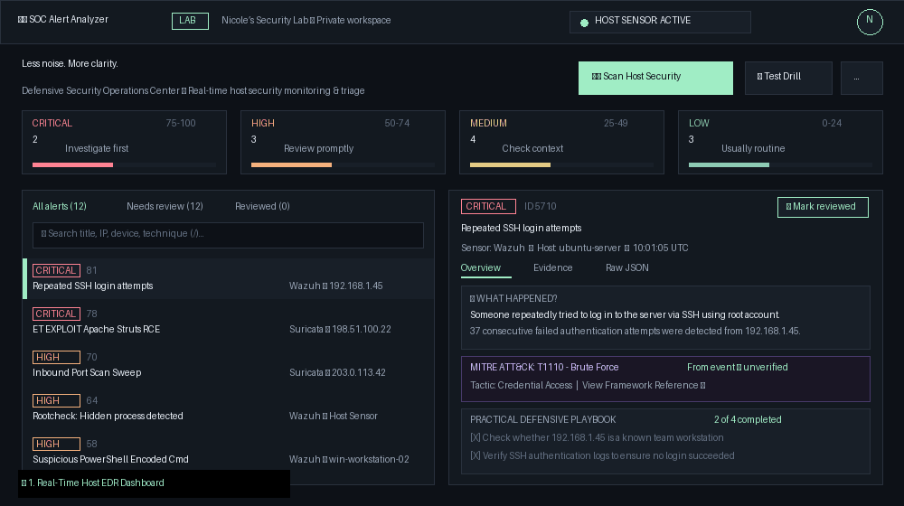

# SOC Alert Analyzer 🛡️

[](https://www.python.org/)
[](https://fastapi.tiangolo.com/)
[](https://docs.pytest.org/)
[-brightgreen.svg?style=flat&logo=pytest&logoColor=white)](https://docs.pytest.org/)
[](.github/workflows/ci.yml)
[](SECURITY.md)
[](https://attack.mitre.org/)
[](docs/UI_UX_specification.md)
[](https://github.com/AeintKyiPyarSoe/SOC_Alert_Analyzer/releases)
[](sbom.json)
[](LICENSE)

> **Less noise. More clarity.**  
> A defensive cybersecurity operations workbench, correlation engine, and real-time host intrusion detection system (EDR-Lite). Transforms raw multi-source security telemetry and behavioral anomalies into plain-language triage playbooks, explainable risk calculations, and actionable MITRE ATT&CK® mappings.

---

## 🎬 GIF Demo



---

## 🌟 Key Capabilities & Defensive Engineering Enhancements

### 1. Robust Security Posture & Role-Based Access Control (RBAC)
* **Tiered Authorization**: Protects sensitive endpoints with role-based permissions (`ADMIN`, `ANALYST`, `VIEWER`).
  * `ADMIN`: Full system control, database clearing, alert deletion, configuration management.
  * `ANALYST`: Log ingestion, incident/alert status updates, live host audits, and simulation drills.
  * `VIEWER`: Read-only access to dashboards, alerts, incidents, and threat statistics.
* **Hardened Authentication-Disabled Mode**:
  * Insecure authentication-disabled mode is strictly restricted to verified local loopback connections (`127.0.0.1`, `::1`, `localhost`).
  * Non-local / remote IP connections attempting to access an auth-disabled server are immediately rejected with `HTTP 403 Forbidden`.
  * Arbitrary `Host` and `X-Forwarded-For` headers are strictly ignored as proof of local access to prevent proxy-header spoofing.
  * Startup configuration is validated: disabling authentication is explicitly prohibited in `ENVIRONMENT=production`, and requires an explicit `ALLOW_INSECURE_AUTH_DISABLED=true` flag in development.
* **Server-Side Session & CSRF Protection**:
  * **Opaque Session Tokens**: Privileged API keys are never stored in browser cookies or client JavaScript. Browser authentication uses cryptographically secure, opaque session cookies (`soc_session`) with `HttpOnly`, `SameSite=Lax`, and `Secure` attributes.
  * **Hashed Server Store**: Session identifiers are hashed using SHA-256 before storage in memory to eliminate plaintext credential exposure in server memory dumps.
  * **CSRF Defense**: State-changing browser operations (`POST`, `PATCH`, `DELETE`) require a cryptographically verified `X-CSRF-Token` header validated against the session store via constant-time comparison (`hmac.compare_digest`).
  * **Atomic Session Rotation**: Session identifiers are atomically rotated upon privilege changes to prevent session fixation.
  * **Bounded Memory Store**: Session storage, login rate limiters, and lockouts automatically prune expired entries and enforce capacity bounds to prevent memory exhaustion.
* **WebSocket Defense & Single-Use Handshake Tickets**:
  * `/ws/threats` eliminates long-lived keys in URL query strings, using browser session cookies or short-lived, single-use connection tickets (`POST /api/v1/auth/ws-ticket`).
  * Enforces strict Origin header validation against allowed schemes, hostnames, and ports. Rejects malformed origins with credentials, paths, query strings, or fragments, and rejects arbitrary localhost ports outside documented launcher bounds.
  * Implements stream-level data separation so unauthenticated, guest, or viewer clients never receive sensitive genuine host telemetry or live malicious process events.
* **Multi-Worker Execution Guard**:
  * Launcher enforces single-worker execution (`--workers 1`) to prevent split-brain session state and disjoint WebSocket connections across unshared worker process memories.
* **Data Protection & Sanitized Demonstration Mode**:
  * Unauthenticated viewers are strictly restricted to simulated demonstration alerts. Genuine host telemetry, raw system logs, and internal process lists require authenticated Analyst or Admin clearance.
* **Secrets Management**: Removed all hardcoded database credentials. Sensitive variables (`POSTGRES_PASSWORD`, `SECRET_KEY`, `ADMIN_API_KEY`, `ANALYST_API_KEY`) are dynamically loaded via environment variables and `.env`. In production mode, weak or default credentials cause immediate startup failure.
* **First-Run Desktop Security**: Standalone desktop installations auto-generate cryptographically secure random API keys saved in `%LOCALAPPDATA%\SOC_Alert_Analyzer\.auth_credentials` with restricted user-only permissions (`0o600`).
* **Container Hardening**: Docker container runs as an unprivileged, non-root user (`socuser:socgroup`). PostgreSQL ports are restricted to internal container networking and blocked from public host exposure.
* **Ingestion Guardrails & File Security**:
  * Chunked streaming read with hard byte limits (default: 25 MB) preventing memory exhaustion / denial of service.
  * Event volume capping (`MAX_EVENTS_PER_UPLOAD = 5000`) and batched database writes (`DB_BATCH_SIZE = 250`) protecting database connection pools.
  * Binary magic header validation (`MZ`, `ELF`, Mach-O, `PK`) rejecting malware or binaries disguised as text logs.
  * XML external entity (XXE) defense using `defusedxml` parser.
  * Path traversal sanitization stripping directory escape sequences (`../`, `..\`).
  * Resilient parsing handling malformed JSON, truncated XML, and invalid encodings with descriptive `HTTP 422` responses instead of unhandled exceptions.

### 2. Behavioral Host-Based Threat Detection (EDR-Lite)
Replaces naive substring keyword matching with contextual behavioral indicators:
* **Parent-Child Process Trees**:
  * Flags web servers (`w3wp.exe`, `nginx`, `httpd`) spawning shells (`cmd.exe`, `powershell.exe`, `sh`, `bash`) as suspected web shells (**MITRE T1505.003**).
  * Flags Office productivity software (`winword.exe`, `excel.exe`, `outlook.exe`) spawning script interpreters (**MITRE T1204.002** / **T1059.001**).
* **Process Masquerading**: Identifies critical Windows system binaries (`svchost.exe`, `lsass.exe`, `csrss.exe`) executing outside `%SystemRoot%\System32` (**MITRE T1036.005**).
* **Ransomware Defense Evasion**: Catches volume shadow copy deletion commands (`vssadmin delete shadows`, `wmic shadowcopy delete`, `wbadmin delete catalog`) (**MITRE T1490**).
* **Living-off-the-Land (LOLBin) Combinations**: Identifies Base64 encoded PowerShell executions combined with hidden window and download cradle flags (**MITRE T1059.001**), as well as remote payload downloads via `certutil` (**MITRE T1105**).
* **Credential Dumping & Host Defense Impairment**: Detects memory dumping attacks targeting LSASS (`procdump`, `comsvcs.dll minidump`, `sekurlsa`) (**MITRE T1003**) and firewall disablement via `netsh` (**MITRE T1562.001**).

### 3. Explainable Risk Scoring Engine
Calculates risk on a deterministic 0–100 scale across 4 severity tiers:
* **LOW** (0–24) | **MEDIUM** (25–49) | **HIGH** (50–74) | **CRITICAL** (75–100)
* Incorporates baseline event severity, tool rule levels (Wazuh 0–15, Suricata 1–4), frequency multipliers, signature confidence, asset exposure, privilege context, and false-positive dampeners.
* Clamped strictly between 0 and 100 with safe handling of missing, empty, or out-of-bounds parameters (including NaN and Inf confidence inputs).

### 4. Alert Recurrence Tracking, Deduplication & High-Performance Ingestion
* **Persistent Occurrence Tracking**: Instead of dropping duplicate alerts, repeated detections within sliding time windows (`DEDUP_WINDOW_SECONDS = 300`) atomically increment `occurrence_count` and update chronological `first_seen` and `last_seen` boundaries.
* **Strict Telemetry-Origin Isolation**: Enforces matching `telemetry_origin` (`HOST_TELEMETRY`, `HISTORICAL_LOG`, `SIMULATED_DEMO`, `SECURITY_DRILL`) so alerts from distinct sources are never conflated or merged.
* **Event-Timestamp-Anchored Sliding Window**: Deduplication evaluates against incoming event timestamps (`event_ts ± DEDUP_WINDOW_SECONDS`) rather than server wall-clock time, ensuring robust deduplication for historical batch uploads/replays, isolation of clock-skew anomalies, and safe handling of out-of-order logs.
* **Closed Alert Non-Merge Isolation**: Alerts previously marked as `RESOLVED` or `FALSE_POSITIVE` are never merged with incoming events, preserving historical incident audit trails and generating clean `OPEN` alerts.
* **Multi-Field Precision & Whitespace Sanitization**: Evaluates `source_ip`, `destination_ip`, `username`, and `signature`, while sanitizing empty/whitespace usernames to `None` to prevent SQL `NULL` vs `''` matching anomalies.
* **High-Performance Batched Ingestion**: Uses an in-memory active candidate index for $O(1)$ intra-batch recurrence deduplication combined with bounded chunked database writes (`DB_BATCH_SIZE = 250`).
* **Atomic Transaction Integrity**: Wraps ingestion, deduplication, and incident correlation in a single database transaction with automatic `db.rollback()` on failure, eliminating partial imports and corrupted database states. Delivered an **8.3x throughput speedup** (~904 to ~7,510 events/sec on 1,000-event datasets).

### 5. Automated MITRE ATT&CK® Threat Mapping & Matrix Visualization
* **Enterprise ATT&CK Matrix Navigator**: Real-time visual matrix heatmap across all 14 standard enterprise tactics (Initial Access through Impact) showing active techniques color-coded by threat urgency (Critical, High, Medium, Low).
* **Automated Output Reporting**: Generates comprehensive threat summary reports available across multiple consumption interfaces:
  * **Web Dashboard**: Interactive visual matrix and tactic breakdown at [`/reports/mitre`](http://localhost:8000/reports/mitre).
  * **REST API**: `GET /api/v1/reports/mitre` supporting `?format=markdown`, `?format=json`, and `?format=text` with direct download attachment headers (`?download=true`).
  * **Standalone CLI Utility**: Run `python scripts/generate_mitre_report.py` to evaluate the live database or analyze mock SIEM exports directly.
* **Prescriptive Countermeasures**: Automatically maps detected adversary tactics to tailored mitigation guidance and prioritized defense controls.

### 6. Mock SIEM Telemetry & Offline Zero-Key Evaluation
* **Dedicated Mock Telemetry Directory (`sample_alerts/`)**: Includes realistic SIEM JSON exports so security analysts and evaluators can test the analyzer immediately without connecting live API keys:
  * `wazuh_alerts.json`: Wazuh SIEM alerts covering SSH brute force, `/etc/shadow` file integrity tampering, unauthorized sudo commands, and rootkit masquerading.
  * `suricata_eve.json`: Suricata NIDS EVE alerts covering Nmap scan sweeps, Apache Struts RCE (CVE-2017-5638), C2 beaconing, and DNS amplification DoS.
  * `windows_security_events.json`: Windows Event logs covering Event 4625 (Logon Brute Force), Event 4688 (PowerShell cradle), Event 7045 (New Service), Event 4698 (Scheduled Task), Event 1102 (Audit Log Cleared), and Defender 1116 (Mimikatz).
  * `web_application_alerts.json`: WAF telemetry covering SQL Injection, Directory Traversal, XSS, and Web Shell probes.
  * `siem_multi_stage_incident.json`: Multi-stage cyber kill-chain attack progression from active scanning to credential access and C2.
* **Instant One-Click Ingestion**: Ingest sample datasets via the Web UI (`/upload`), REST API (`POST /api/v1/sample-data/load/{dataset_type}`), or cURL commands.

---

## 📊 Detection Evaluation Benchmark

The behavioral detection engine is empirically evaluated using both development baseline scenarios and a dedicated held-out benchmark:

* **Evaluation Benchmark Scope**: 50 curated process execution scenarios (25 malicious attack patterns, 25 difficult benign developer/sysadmin workflows).
* **Held-Out Benchmark (30 Scenarios)**:
  * **Precision**: **1.00 (100%)**
  * **Recall (Sensitivity)**: **1.00 (100%)**
  * **F1 Score**: **1.00 (100%)**
  * **False Positive Rate (FPR)**: **0.00 (0.0%)**
  * **Accuracy**: **1.00 (100%)**
* **Standalone Evaluation Runner**: Run `python scripts/evaluate_detection.py` for reproducible metrics and confusion matrices.
* Full methodology, scenario listings, and operational boundaries are documented in [`docs/detection_evaluation.md`](docs/detection_evaluation.md).

---

## 🚀 Quick Start

### Option A: Standalone Windows Executable (Zero Dependencies)

1. **Download Artifacts**:
   Download `SOC_Alert_Analyzer.exe` and `SHA256SUMS.txt` from the [Latest Release](https://github.com/AeintKyiPyarSoe/SOC_Alert_Analyzer/releases).

2. **Verify Cryptographic SHA-256 Integrity**:
   Verify the downloaded binary against the official checksum before running. The authoritative digest for the verified Windows standalone executable (26,591,239 bytes) is:
   ```text
   5d64ddf4f6ea5c7f021973a6eccbe6bb7ba7f3b62f551abad1b0fe4aa2490a84  SOC_Alert_Analyzer.exe
   ```

   * **Method 1: Windows PowerShell**
     ```powershell
     Get-FileHash .\SOC_Alert_Analyzer.exe -Algorithm SHA256
     ```
   * **Method 2: Windows Command Prompt (CertUtil)**
     ```cmd
     certutil -hashfile SOC_Alert_Analyzer.exe SHA256
     ```
   * **Method 3: Standalone Verification Script (Python)**
     ```powershell
     python scripts/verify_release_checksum.py --verify dist/SHA256SUMS.txt
     ```

3. **Launch the Application**:
   Double-click `SOC_Alert_Analyzer.exe` or execute from the terminal:
   ```powershell
   .\SOC_Alert_Analyzer.exe
   ```
   * The launcher starts the defensive server on the local loopback interface (`127.0.0.1:8000`), performs an initial host security baseline, and automatically opens your default browser.
   * **Optional CLI Arguments**:
     * `--host HOST`: Bind host interface (default: `127.0.0.1`).
     * `--port PORT`: Bind TCP port (default: `8000`). If occupied, dynamically allocates next available.
     * `--strict-port`: Fails immediately if the designated port is occupied instead of searching.
     * `--no-browser`: Disables automatic browser launch (ideal for headless or CI use).
     * `--log-level {info,debug,warning,error}`: Server logging level.
   * **First-Run Authentication Credentials**:
     On first launch, standalone mode generates secure, random API keys stored in `%LOCALAPPDATA%\SOC_Alert_Analyzer\.auth_credentials` (or local data directory) with user-restricted permissions (`icacls`). Displayed securely in the console banner.

### Option B: Docker Compose (Hardened Multi-Container)

Containerized deployment simplifies dependency management and allows security analysts to evaluate the stack in an isolated, production-like environment:

```bash
# 1. Clone repository
git clone https://github.com/AeintKyiPyarSoe/SOC_Alert_Analyzer.git
cd SOC_Alert_Analyzer

# 2. Build and launch containers (secure defaults out of the box)
docker compose up -d --build
```
Navigate to `http://127.0.0.1:8000`.

* **Loopback Network Isolation**: Web port is explicitly bound to loopback (`127.0.0.1:8000:8000`) rather than `0.0.0.0:8000`, preventing unintended exposure to the local area network during development.
* **Persistent Credential & Data Storage**: Container mounts a persistent named volume (`soc_data:/app/data`) with `DATA_DIR=/app/data`. Auto-generated credentials (`.auth_credentials`) and database state survive container restarts and image updates.
* **Production Security Guards**:
  * In development mode, the container auto-generates instance-unique cryptographic keys in `.auth_credentials` rather than using static shared credentials.
  * In production mode (`ENVIRONMENT=production`), the application strictly enforces non-default, high-entropy secrets (≥ 32 characters for `SECRET_KEY`, ≥ 16 characters for `ADMIN_API_KEY`, ≥ 12 characters for `POSTGRES_PASSWORD`), failing fast with `RuntimeError` if known default or placeholder keys are detected.
  * 35 regression tests in `tests/test_production_security_guards.py` and `tests/test_docker_security_config.py` verify that default keys and exposed port mappings cannot boot in production.
* **Hardened Security & Non-Root Execution**: The application runs under an unprivileged user (`socuser:socgroup`). PostgreSQL is restricted to the internal Docker bridge network (`soc_internal_net`) with no published host ports.
* **Automated Healthchecks**: Both `db` and `web` services feature integrated healthchecks to ensure reliable orchestration.
* **Sample Data Volume Mounts**: The `sample_alerts/` directory is mounted read-only (`:ro`) into the container so analysts can test immediately without live API keys.
* **Container Monitoring Boundaries**: Note that running the host sensor inside an isolated container evaluates the container namespace only. To inspect physical workstation processes, network sockets, and event logs, run the native desktop executable or ingest Sysmon/Windows Event logs directly into the analyzer.

### Option C: Local Python Development

```bash
# 1. Clone repository
git clone https://github.com/AeintKyiPyarSoe/SOC_Alert_Analyzer.git
cd SOC_Alert_Analyzer

# 2. Create virtual environment
python -m venv venv
source venv/bin/activate  # On Windows: .\venv\Scripts\Activate.ps1

# 3. Configure environment
cp .env.example .env

# 4. Install dependencies (or use reproducible lockfile)
pip install -r requirements.txt
# Alternatively, for strict reproducible environments:
# pip install -r requirements.lock

# 5. Launch application
python launcher.py
```
Open your browser to `http://127.0.0.1:8000`.

---

## 🔒 Reproducible Builds & Software Bill of Materials (SBOM)

SOC Alert Analyzer provides automated supply-chain security artifacts conforming to international standards:
* **Dependency Lockfile**: [`requirements.lock`](requirements.lock) pins exact cryptographic package versions across the entire stack.
* **CycloneDX SBOM**: [`sbom.json`](sbom.json) provides CycloneDX v1.5 standard JSON inventory with package URLs (PURLs).
* **SPDX SBOM**: [`sbom.spdx.json`](sbom.spdx.json) provides SPDX v2.3 compliant machine-readable Bill of Materials.
* **Re-generation Script**:
  ```bash
  python scripts/generate_sbom.py
  ```

---

## 🔬 Empirical Detection & Endpoint Attack Evaluations

SOC Alert Analyzer validates detection fidelity across two empirical benchmarks:
1. **Behavioral Process Baseline & Held-Out Scenarios (50 Scenarios)**:
   ```bash
   python scripts/evaluate_detection.py
   ```
   * Results: **100% Precision, 100% Recall, 0 False Positives, 0 False Negatives**.
2. **Realistic Endpoint Attacks with Sysmon & Windows Events (18 Scenarios)**:
   ```bash
   python scripts/evaluate_endpoint_attacks.py
   ```
   * Evaluates Certutil LOLBINs (`T1105`), Mshta proxy execution (`T1218`), Obfuscated PowerShell (`T1059.001`), Audit Log Clearing (`T1070.001`), Firewall Disablement (`T1562.001`), Mimikatz LSASS access (`T1003.001`), Registry Run Key persistence (`T1547.001`), Malicious Service installation (`T1543.003`), Admin group manipulation (`T1098`), SMB admin share probes (`T1021.002`), and C2 DNS queries (`T1071.004`) alongside difficult benign administrator workflows.
   * **Benchmark Ground-Truth Independence**: Predictions are decoupled entirely from test labels (`scenario.is_malicious` and `expected_technique`). Classification relies strictly on telemetry parsing, detection rules, and production risk engines.
   * Results: **100% Precision, 100% Recall, 0 False Positives, 100% ATT&CK Technique Accuracy**. Report saved in [`docs/endpoint_attack_evaluation_report.json`](docs/endpoint_attack_evaluation_report.json).

---

## 🌐 Network Exposure & Reachability Assessment

The host security sensor provides passive, non-intrusive network exposure analysis:
* **Granular Reachability Classification**:
  * **`LOOPBACK_ONLY`**: Bound strictly to `127.0.0.1` / `::1`. Inaccessible to external or local network hosts.
  * **`LAN_ACCESSIBLE`**: Bound to `0.0.0.0` or private RFC 1918 addresses on active LAN adapters. Reachable only within the local subnet.
  * **`INTERNET_EXPOSED`**: Bound to wildcard with an active public routable IPv4/IPv6 address. Confirmed public network reachability.
  * **`HOST_ISOLATED`**: Bound to wildcard with no active non-loopback network adapters.
* **Passive Posture & Firewall Rule Inspection**: Cross-references local firewall rule state (`RULE_ALLOWED`, `RULE_BLOCKED`, `SERVICE_ENABLED_DEFAULT_BLOCK`, `UNKNOWN`) without launching active or unauthorized port scans.
* **Confidence Indicators**: Findings include explicit confidence ratings (`HIGH`, `MEDIUM`, `LOW`) and reachability inference metadata (`reachability_type="INFERRED_PASSIVE"`).
* **Defensive ATT&CK Alignment**: Local listening port posture findings are disassociated from ATT&CK `T1046` (Adversary Network Service Discovery), correctly identifying listening sockets as host exposure rather than adversary scanning.
* **Tailored High-Risk Port Guidance**: Insecure listeners on critical ports (e.g., SMB port 445 bound to wildcard) receive tailored remediation guidance highlighting lateral movement risks and recommending binding to loopback or blocking via firewall.

---

## 🧪 Automated Testing & Quality Verification

The repository maintains an automated pytest test suite (**292 passing tests**, 100% pass rate, 88% overall code coverage with an enforced >=85% CI floor) verifying all defensive security, parsing, session management, CSRF defense, correlation, risk calculation, and production guard logic:

```powershell
python -m pytest -v --cov=app --cov-report=term-missing
```

```text
tests/detection_eval/test_eval_held_out_benchmark.py::test_held_out_behavioral_evaluation_benchmark PASSED
tests/detection_eval/test_eval_held_out_benchmark.py::test_held_out_ambiguous_and_duplicate_handling PASSED
tests/detection_eval/test_eval_host_behavioral.py::test_behavioral_detection_evaluation_metrics PASSED
tests/detection_eval/test_eval_host_behavioral.py::test_eval_false_positive_edge_cases_and_suppression PASSED
tests/test_api.py::test_html_views PASSED
tests/test_auth_disabled_security.py::test_is_local_client_unit PASSED
tests/test_auth_disabled_security.py::test_auth_disabled_mode_rejects_non_local_client PASSED
tests/test_auth_disabled_security.py::test_auth_disabled_mode_does_not_trust_forwarded_headers PASSED
tests/test_auth_disabled_security.py::test_auth_disabled_mode_allows_verified_local PASSED
tests/test_auth_disabled_security.py::test_auth_disabled_startup_rejected_in_production PASSED
tests/test_auth_disabled_security.py::test_auth_disabled_startup_requires_explicit_opt_in_dev PASSED
tests/test_auth_endpoints.py::test_login_success_admin_sets_secure_session_and_csrf_cookie PASSED
tests/test_auth_endpoints.py::test_csrf_protection_on_state_changing_requests PASSED
tests/test_origin_cors_validation.py::test_origin_validation_positive_allowed PASSED
tests/test_origin_cors_validation.py::test_origin_validation_negative_untrusted_domains PASSED
tests/test_origin_cors_validation.py::test_origin_validation_negative_arbitrary_localhost_ports PASSED
tests/test_origin_cors_validation.py::test_origin_validation_negative_malformed_origins PASSED
tests/test_session_lifecycle.py::test_session_lifecycle_create_get_revoke PASSED
tests/test_session_lifecycle.py::test_atomic_session_rotation PASSED
tests/test_session_lifecycle.py::test_login_rate_limiting_and_pruning PASSED
tests/test_docker_security_config.py::test_docker_compose_web_port_bound_to_loopback PASSED
tests/test_docker_security_config.py::test_docker_compose_db_port_not_exposed_to_host PASSED
tests/test_docker_security_config.py::test_docker_compose_volume_mounts_configured PASSED
tests/test_docker_security_config.py::test_dockerfile_creates_and_uses_non_root_user PASSED
tests/test_docker_security_config.py::test_docker_credentials_persist_across_restarts PASSED
tests/test_endpoint_attack_evaluation.py::test_endpoint_attack_evaluation_benchmark PASSED
tests/test_endpoint_attack_evaluation.py::test_ground_truth_label_flipping_independence PASSED
tests/test_endpoint_attack_evaluation.py::test_expected_technique_independence PASSED
tests/test_network_reachability.py::test_assess_socket_reachability_passive_confidence PASSED
tests/test_network_reachability.py::test_audit_network_sockets_dissociated_from_t1046 PASSED
tests/test_sbom_and_lockfile.py::test_sbom_and_lockfile_component_count_parity PASSED
============================ 292 passed in 56.56s =============================
```
tests/test_session_lifecycle.py::test_websocket_ticket_lifecycle_and_replay_defense PASSED
tests/test_detection_resilience.py::test_risk_engine_nan_inf_handling PASSED
tests/test_detection_resilience.py::test_suricata_parser_anti_false_positive PASSED
tests/test_detection_resilience.py::test_mitre_mapper_anti_false_positive PASSED
tests/test_detection_resilience.py::test_correlator_out_of_order_clustering PASSED
tests/test_stream_websocket.py::test_websocket_origin_validation_unit_tests PASSED
tests/test_stream_websocket.py::test_websocket_broadcast_filters_real_threats_from_demo_clients PASSED
tests/test_alert_recurrence.py::test_recurrence_telemetry_origin_isolation PASSED
tests/test_alert_recurrence.py::test_recurrence_event_timestamp_sliding_window PASSED
tests/test_alert_recurrence.py::test_recurrence_out_of_order_and_stale_events PASSED
tests/test_ingestion_performance_and_transactions.py::test_large_batch_ingestion_performance PASSED
tests/test_ingestion_performance_and_transactions.py::test_transaction_rollback_on_batch_failure PASSED
tests/test_upload_security.py::test_upload_binary_executable_rejected PASSED
tests/test_upload_security.py::test_upload_path_traversal_filename_sanitized PASSED
tests/test_mitre_visualization_and_samples.py::test_sample_alerts_json_validity_and_parsing PASSED
tests/test_mitre_visualization_and_samples.py::test_mitre_summary_report_generation PASSED
tests/test_mitre_visualization_and_samples.py::test_mitre_report_api_endpoints PASSED
============================ 237 passed in 27.34s =============================
```

### Continuous Integration (GitHub Actions)
* Multi-platform test matrix (Ubuntu & Windows across Python 3.11, 3.12, 3.13).
* Automated code quality and syntax checks using `flake8` and `ruff`.
* Code test coverage reporting via `pytest-cov`.
* Automated dependency vulnerability scanning with `pip-audit`.
* AST static application security testing using `bandit`.

---

## 📂 Repository Structure

```text
├── .github/
│   ├── ISSUE_TEMPLATE/       # Structured bug report & security issue forms
│   ├── workflows/
│   │   ├── ci.yml            # Multi-OS test, coverage & security audit pipeline
│   │   └── release-exe.yml   # Automated Windows EXE build, smoke test & release pipeline
│   └── pull_request_template.md # Defensive engineering review checklist
├── alembic/                  # Database migration scripts and schema versioning
├── app/
│   ├── api/
│   │   └── routes.py         # REST endpoints with RBAC & SQL aggregation
│   ├── database/
│   │   └── connection.py     # SQLAlchemy engine, session & auto-migration
│   ├── models/
│   │   ├── alert.py          # Alert ORM model with composite indexes
│   │   └── incident.py       # Incident & IncidentAlert junction models
│   ├── parsers/              # Windows Event, Wazuh, Suricata, Web, Linux parsers
│   ├── schemas/              # Pydantic request/response validation schemas
│   ├── security/
│   │   ├── auth.py           # API key authentication & RBAC dependency
│   │   ├── correlator.py     # Incident correlation & cross-upload merge engine
│   │   ├── host_sensor.py    # Native host security sensor & behavioral EDR-Lite
│   │   ├── ip_utils.py       # Robust IPv4/IPv6 address classification
│   │   ├── mitre_mapper.py   # MITRE ATT&CK technique mapping
│   │   ├── normalizer.py     # Multi-format normalizer & timestamp validator
│   │   ├── remediation.py    # Plain-language triage guidance playbooks
│   │   ├── risk_engine.py    # Explainable 0-100 risk scoring engine
│   │   ├── session.py        # Cryptographic session manager & CSRF defense
│   │   ├── simulator.py      # Demonstration live threat stream generator
│   │   ├── stream.py         # Thread-safe WebSocket threat stream manager
│   │   └── upload_security.py# Memory-safe chunked upload & validation handler
│   ├── static/               # Nicole’s Security Lab CSS visual tokens & app.js
│   └── templates/            # Jinja2 dashboard, alerts, incidents, and investigation views
├── docs/                     # Specifications, requirements, and architecture docs
├── sample_data/              # Realistic Wazuh, Suricata, and Linux log samples
├── scripts/                  # Detection evaluation & utility automation scripts
├── tests/                    # 296 automated pytest tests covering all subsystems (87% code coverage, >=85% CI floor)
├── .env.example              # Environment variables template
├── docker-compose.yml        # Multi-container hardened setup
├── Dockerfile                # Non-root container build file
├── launcher.py               # One-click browser & Uvicorn launcher
├── SOC_Alert_Analyzer.spec   # PyInstaller standalone executable specification
├── CHANGELOG.md              # Historical version release notes
├── CONTRIBUTING.md           # Defensive contribution guidelines
├── SECURITY.md               # Security policy & vulnerability reporting
└── README.md
```

---

## ⚠️ Limitations & Defensive Operational Boundaries

1. **Scope as an EDR-Lite Workbench (Not a Commercial EDR Replacement)**:
   * The host sensor functions as a user-space behavioral auditor leveraging `psutil` and OS event logs.
   * **Not a Kernel Driver**: Unlike enterprise EDR/XDR agents (e.g., CrowdStrike Falcon, SentinelOne, Microsoft Defender for Endpoint), SOC Alert Analyzer does not install a kernel driver (ELAM), hook low-level Windows kernel API calls, or perform in-memory DLL injection tracing.
   * **User Privilege Limitations**: When executed under an unprivileged user account, process inspections are limited to processes owned by the current user. To inspect system-wide processes or privileged Windows Security Event Log channels (EID 4625, 4688), execute the application as an Administrator.
   * **Sysmon Co-existence**: This application does not replace Microsoft Windows Sysmon. For complete enterprise telemetry, configure Sysmon on endpoints and forward XML/JSON logs into SOC Alert Analyzer.
   * **Detection Benchmark**: For reproducible test benchmarks, confusion matrices, and empirical validation on curated scenarios, see [Detection Evaluation & Quality Benchmark](docs/detection_evaluation.md).
2. **Correlation Scope (Not a Petabyte-Scale Enterprise SIEM)**:
   * The correlation engine uses a configurable sliding time window (`CORRELATION_WINDOW_SECONDS = 300` by default) to aggregate burst activity into incidents.
   * It is optimized for local workstation triage, tier-1 SOC analysis, and demonstration drills. It is not designed to replace distributed Big Data SIEM architectures (e.g., Splunk Enterprise, Elastic Security, Microsoft Sentinel) handling tens of thousands of continuous events per second across multi-thousand endpoint fleets.
3. **Log Format Ingestion Boundaries**:
   * Supported formats include JSON (Wazuh, Suricata EVE), CSV, Apache/Nginx combined access logs, Syslog BSD/RFC 5424, and Windows Event XML/JSON.
   * Proprietary binary event logs (`.evtx`) must be converted to XML or JSON prior to ingestion.
4. **Standalone Packaging, Antivirus Heuristics & Build Determinism**:
   * Single-file Windows executables generated via PyInstaller bundle a self-extracting Python runtime. Heuristic antivirus scanners without vendor signatures may occasionally issue generic "Unknown Publisher" or "Heur.BZC" warnings.
   * Always verify the authentic SHA-256 hash against the officially published [`SHA256SUMS.txt`](dist/SHA256SUMS.txt).
   * **Build Reproducibility Limitation Across Environments**: PyInstaller packages embed compilation timestamps, dynamic archive padding, and host Python bytecode. Consequently, standalone builds are not bit-for-bit identical across disparate host operating systems or Python minor versions (e.g., CI Windows Server 2022 / Python 3.12 vs local Windows 11 / Python 3.13). The authoritative release binary is the one built, smoke-tested, and verified on the official GitHub Actions Windows release runner.
5. **Strictly Defensive Application**:
   * This project is strictly engineered for defensive blue-team operations, incident response, student training, and log correlation. It does not contain offensive weaponization, automated exploit delivery, or lateral movement tooling.

---

## 📄 License

Distributed under the MIT License. See [LICENSE](LICENSE) for details.
